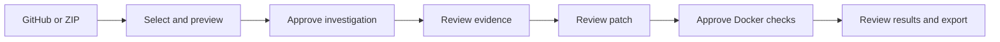

<div align="center">

# DevTwin Engineer

### Understand the code. Review the change. Verify the result.

**An AI code investigation and repair workspace with 13 engineering workflows, GitHub imports, Docker test verification, and Codex / Claude Code skills and plugins.**

[Workflows](#13-engineering-workflows) · [Quick start](#run-locally) · [Agent setup](#skills-and-plugins) · [Project status](docs/completion-status.md)

**Local web application · Evidence reports · Reviewed patches · Isolated Python tests**

</div>

---

## Turn an unfamiliar codebase into an inspectable plan

DevTwin helps developers understand selected source files, investigate bugs, review focused changes, and examine the evidence behind a repair. Connect a GitHub repository or upload a project ZIP, preview the files, and move from investigation to a reviewed patch and isolated verification.

Use the browser workspace independently of a Codex or Claude installation, or install the shared engineering skill in your coding agent. The web workspace needs its own backend and configured model provider; isolated verification also requires Docker.

**DevTwin's goal: make AI-assisted engineering easier to inspect, reproduce, and review.**

## Three views. One connected workspace.

| View | What you can do |
| --- | --- |
| **Welcome** | Meet the creator, explore DevTwin, and follow CLI and supported plugin-browser setup guides. |
| **Project Explorer** | Import GitHub files or a ZIP, inspect source and SHA-256 hashes, review selection sizes, and see why files were omitted. |
| **Workflow board** | Run investigations, review reports, propose a patch, approve export, compare tests in Docker, or run a bounded repair loop. |



GitHub imports are **read-only and pinned to a commit**. The web app does not push changes, open pull requests, or apply generated patches to your original repository.

## 13 engineering workflows

| Workflow | What it helps you investigate |
| --- | --- |
| **Repository understanding** | Structure, entry points, responsibilities, and conventions. |
| **Feature tracing** | How behavior travels through the selected source. |
| **Change impact** | Affected callers, contracts, and assumptions. |
| **Bug reproduction** | A focused reproduction and any missing prerequisites. |
| **Dependency diagnosis** | Dependency requirements and environment assumptions. |
| **Implementation** | A focused change grounded in the available evidence. |
| **Regression testing** | Checks that expose a bug and protect existing behavior. |
| **API compatibility** | Interface changes and consumer expectations. |
| **Database review** | Schema, migration, and data assumptions. |
| **Security review** | Concrete trust boundaries and security-sensitive paths. |
| **Performance investigation** | Measurement and profiling opportunities. |
| **Documentation verification** | Whether supplied documentation matches supplied source. |
| **Delivery preparation** | Evidence and unresolved checks for a change review. |

**One control can queue all 13 source investigations.** After separate approval for up to 13 provider calls, DevTwin runs them sequentially with pacing, per-workflow progress, error reporting, stop-after-current control, and combined JSON export. This batch does not automatically change code or execute tests.

## From a bug report to a reviewed repair

For a small Python module and its standard-library tests, try a task such as:

> Investigate why this function returns the wrong result for an empty input. Propose a minimal fix, preserve the selected tests, and identify the evidence needed to verify it.

1. **Connect and select:** import explicit files and inspect the actual analysis scope.
2. **Prepare an investigation:** choose a workflow, describe the task, and approve the displayed provider/data policy.
3. **Review the evidence:** inspect source-linked findings, proposed checks, limitations, and a downloadable report.
4. **Propose and review a change:** inspect the diff and full replacement for one selected, existing non-test file. Approve selected-file ZIP export separately.
5. **Verify in an isolated runner:** approve original/candidate Python tests in separate disposable Docker containers.
6. **Run a bounded repair loop:** approve one investigation, up to two proposals, and up to two baseline/candidate check attempts. A second proposal follows failing checks only.

A **demonstrated repair** requires observed baseline failure and candidate success. When both versions pass, DevTwin reports checks passing without claiming a demonstrated fix. Missing prerequisites, provider failures, and blocked execution stay visible.

## Run locally

Prerequisites: a source checkout, **Python 3.10+**, Docker with Linux containers, and a supported model-provider key. The exercised runner uses a pinned Python 3.12 image. Node.js is required for web development tests.

From the repository root, prepare a fresh installation:

```sh
docker pull python:3.12-slim
docker pull docker:cli
python scripts/prepare_docker.py .
```

Preparation records image digests and creates ignored `.env.docker` with separate random app and worker tokens. It refuses to overwrite existing configuration.

Start with the supported OpenRouter free-only route:

```sh
python scripts/start_openrouter.py
```

The helper prompts for the key without displaying it, sends a bounded synthetic smoke request, and starts the Docker app if that succeeds. It does not save the key to a project file; Docker retains it in the app container environment.

Some free routes require allowing upstream storage/training. **Only if you accept those terms for public or synthetic inputs**, use:

```sh
python scripts/start_openrouter.py --allow-public-inputs
```

Open **[http://127.0.0.1:8765/](http://127.0.0.1:8765/)**. Enter `DEVTWIN_SESSION_TOKEN` from `.env.docker` in **Workspace session token**. Provider and GitHub API keys belong in backend configuration, never in that field.

Free-only routing prevents intentional paid-model fallback. Provider capacity, quotas, and continued free availability are external constraints. See [OpenRouter setup](docs/openrouter.md), [Docker instructions](docs/docker.md), and [free hosting prerequisites](docs/free-hosting.md).

## Skills and plugins

Install the canonical skill into an existing project:

```sh
# Codex project skill
python scripts/install_skill.py . /path/to/project --runtime codex

# Claude Code project skill
python scripts/install_skill.py . /path/to/project --runtime claude-code
```

Start a fresh session in that project. Invoke `$devtwin-engineer` in Codex or `/devtwin-engineer` in Claude Code. Installation refuses existing destinations and does not change user-wide settings.

Build a fresh local plugin marketplace:

```sh
python scripts/build_plugins.py . dist/plugin-marketplace-new
```

Follow the [plugin setup guide](docs/plugins-and-web.md), [Codex adapter](integrations/codex/README.md), or [Claude Code adapter](integrations/claude-code/README.md) for installation and discovery. Packages are development candidates, not published marketplace listings. Codex execution and plugin discovery have been exercised; Claude package validation passed, while Claude model execution remains deferred.

## Current evidence and boundaries

| Area | Current scope |
| --- | --- |
| **Local web app** | Three views, selected-file imports, source investigations, reviewed patch export, Docker verification, and bounded repair. |
| **13 workflows** | Prerequisite resource audit, synthetic source-analysis coverage, and batch orchestration checks. Every model finding still needs review. |
| **Latest recorded checks** | 151 Python cases: **149 passed, 2 Windows symlink skips**. **22 web tests passed**. See [increment 35](docs/increment-35.md). |
| **Selection limits** | Up to 30 UTF-8 files, 16,000 total selected bytes, and a 2 MiB ZIP. Only selected files are analyzed. |
| **Test execution** | Standard-library Python `unittest`; no automatic dependency installation or arbitrary-language runner. |
| **Isolation** | Disposable containers with no network, bounded resources/output/time, and no host source mounts or provider credentials. The private worker controls a Docker daemon; public multi-user sandbox hardening is pending. |
| **Evidence quality** | Schema and citation bounds are validated; semantic correctness is not guaranteed. Source analysis alone runs no tests. |
| **Hosting** | The public catalog/setup site is separate from the local execution backend. Public backend deployment remains pending. |
| **Release** | Private development candidate. License and formal release remain undecided; no open-source license is currently granted. |

Selected files and workflow state are held in memory; refreshing loses the session state. Submit only inputs approved for the displayed provider policy.

## Development checks

```sh
python -m unittest discover -s tests -v
python scripts/validate_package.py .
python scripts/check_project.py .
```

The combined checker runs Python tests, declared web suites, package validation, and archive checks. These are development gates, not independent effectiveness benchmarks.

## About the creator

**Raimal Raja is a Machine Learning Engineer and the creator of DevTwin.** His work spans Python, machine learning, computer vision, LLM fine-tuning, FastAPI, and MLOps. DevTwin brings that practical AI engineering focus to developer tools: understand the source, make a focused change, and inspect the evidence behind the result.

[GitHub](https://github.com/Raimal-Raja) · [LinkedIn](https://www.linkedin.com/in/raimal-raja-kolhi-860a032bb/) · [Portfolio](https://coder.kvtech.net)

## Documentation

- [Canonical skill](SKILL.md) and [13 capability prerequisites](docs/capability-prerequisites.md)
- [Installation](docs/installation.md) and [supported environments](docs/supported-environments.md)
- [Repair loop](docs/repair-loop.md) and [evaluation procedure](docs/evaluation.md)
- [Completion status](docs/completion-status.md), [deployment readiness](docs/deployment-readiness.md), and [roadmap](docs/roadmap.md)
- [GitHub About description and suggested topics](docs/github-about.md)
