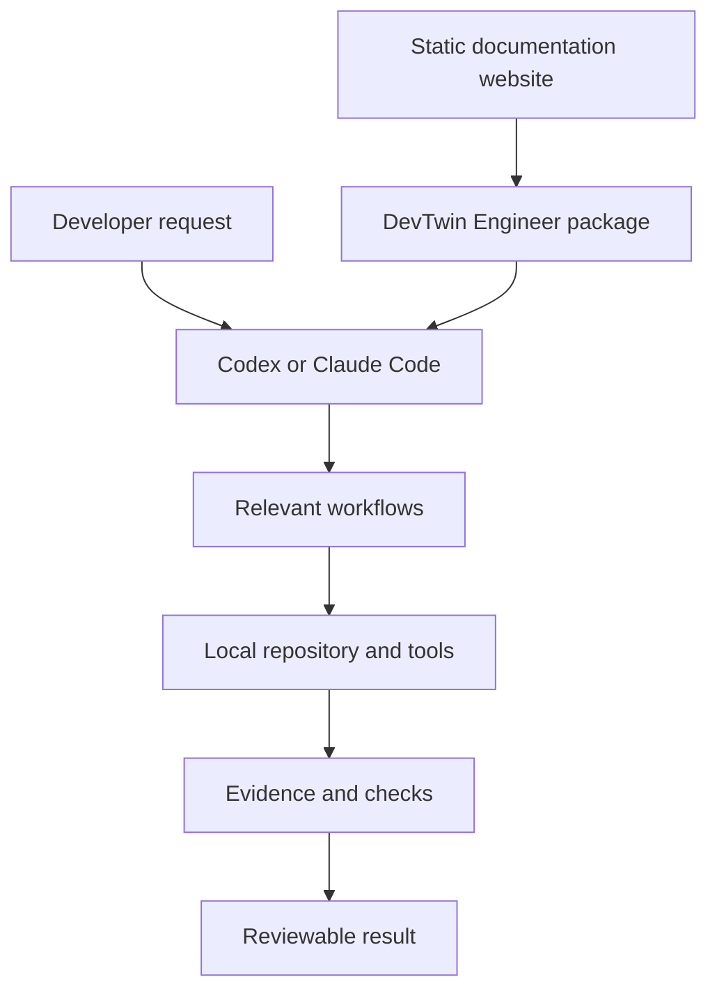

# DevTwin Engineer

**One agent skill. Thirteen engineering capabilities. From unfamiliar repository to verified patch, with evidence at every step.**

> Status: project specification and implementation roadmap. This document does not indicate that the skill, scripts, integrations, website, or benchmarks already exist. All checkboxes are planned work. This project is the unified agent skill package, not the separate DevTwin interactive application-map platform.

## Contents

1. [Vision and intended users](#vision-and-intended-users)
2. [The thirteen capabilities](#the-thirteen-capabilities)
3. [Zero-cost architecture and boundaries](#zero-cost-architecture-and-boundaries)
4. [Create the private repository](#create-the-private-repository)
5. [Proposed repository layout](#proposed-repository-layout)
6. [Skill architecture](#skill-architecture)
7. [Implementation roadmap](#implementation-roadmap)
8. [Evaluation and quality gates](#evaluation-and-quality-gates)
9. [Security and authorization](#security-and-authorization)
10. [Installation and compatibility](#installation-and-compatibility)
11. [Free hosting and website address](#free-hosting-and-website-address)
12. [Distribution and launch](#distribution-and-launch)
13. [Release checklist](#release-checklist)
14. [Future roadmap](#future-roadmap)
15. [Official references](#official-references)

## Vision and intended users

DevTwin Engineer is a reusable workflow skill for Codex and Claude Code. It investigates a repository, selects relevant engineering workflows, makes authorized changes, and verifies the outcome using available evidence.

Initial audience: developers maintaining Python backends. Initial supported project types: a small FastAPI application and a Python library with a meaningful test suite. Expand only after these workflows perform reliably.

Example request:

> Investigate why checkout fails when a discount is missing, fix the problem, check relevant callers, and prepare the result for review.

Expected result: a focused patch, reproduction evidence where possible, relevant test results, an explanation of potential impact, and explicit unresolved limitations.

The skill is an instruction package with optional helper scripts. It is not a new foundation model, a guarantee of correct code, or thirteen agents running simultaneously. Its startup/product value must be established through repeated use and measured improvements; millions of users are an ambition, not a forecast.

## The thirteen capabilities

| # | Capability | Trigger example | Expected evidence/output |
| --- | --- | --- | --- |
| 1 | Repository understanding | Explain this project | Relevant structure, entry points, instructions, conventions |
| 2 | Feature tracing | Explain the checkout flow | Supported paths through handlers, functions, models, integrations |
| 3 | Change-impact investigation | What could this edit affect? | Known callers, interfaces, test references, uncertainty |
| 4 | Bug reproduction | Reproduce this crash | Minimal reproducer or documented blocker |
| 5 | Dependency diagnosis | Installation stopped working | Conflict evidence and verified candidate correction |
| 6 | Focused implementation | Fix the identified issue | Minimal maintainable patch consistent with repository conventions |
| 7 | Regression verification | Check the fix | Meaningful targeted tests and relevant existing checks |
| 8 | API compatibility | Review this response change | Contract differences and affected consumers where known |
| 9 | Database migration review | Review this schema change | Data, compatibility, locking, rollback findings with test scope |
| 10 | Security review | Inspect this authorization path | Concrete findings, reproduction or code evidence, focused fixes |
| 11 | Performance investigation | This endpoint became slow | Measured baseline, profile, candidate comparison |
| 12 | Documentation verification | Check the setup instructions | Verified commands/examples and corrected discrepancies |
| 13 | Delivery preparation | Prepare this change for review | Review summary, validation evidence, release/deployment instructions |

Capabilities activate only when relevant. An explanation request does not authorize editing, a patch request does not automatically authorize production deployment, and a small change should not trigger thirteen reviews.

## Zero-cost architecture and boundaries



| Component | Free approach | Boundary |
| --- | --- | --- |
| Private source repository | GitHub Free private repository | Recheck current account terms and allowances |
| Development | Existing computer, Python, Git, Markdown | Hardware, electricity, and internet are user-provided |
| Skill workflows | Local Markdown references | No mandatory hosted service |
| Helper tests | Local pytest execution | No paid runner required |
| Evaluation fixtures | Small self-authored repositories | No paid datasets or production credentials |
| Agent runtime | User's available Codex/Claude Code setup | Inference is not guaranteed free; existing plan limits apply |
| Website | Static Cloudflare Pages Free | Provider terms and limits apply |
| Address | Available `PROJECT.pages.dev` subdomain | Not an independently registered `.com` domain |
| Distribution | Local package, Git clone, approved downloads | Private source must not be exposed unintentionally |

The repository, package, tests, and documentation website can avoid additional service charges. Codex or Claude Code execution may require a subscription or metered usage. Do not describe the entire agent runtime as universally free. Manual tests and static package validation are possible without inference charges; actual agent evaluation still needs a runtime.

No backend, cloud database, vector database, paid model API, custom domain purchase, or paid analytics is required. Stay within free allowances and use local alternatives rather than enabling billing to remove limits.

## Create the private repository

### Step 1: create on GitHub

- [ ] Name: `devtwin-engineer`, subject to availability.
- [ ] Visibility: Private.
- [ ] Add README and Python `.gitignore`.
- [ ] Enable account two-factor authentication.
- [ ] Decide who may access source and evaluations.
- [ ] Choose a license before distributing the skill; do not imply a license exists before adding it.

Do not alter a GitHub profile repository as part of this project.

### Step 2: clone and branch

Use the actual repository clone URL and configured Git authentication:

```bash
git clone https://github.com/Raimal-Raja/devtwin-engineer.git
cd devtwin-engineer
git switch -c feat/skill-foundation
```

The URL is a proposed repository location, not a verified existing repository.

### Step 3: define ignored content

Exclude virtual environments, local secrets, caches, private logs, generated task workspaces, evaluation outputs containing source, and model files. Commit sanitized fixtures, methodology, and selected shareable results.

### Step 4: establish working practices

Use small commits, focused branches, and reviewable pull requests. Preserve unrelated working-tree changes. Do not enable repository instructions that require paid tools or assume permission to publish.

## Proposed repository layout

```text
devtwin-engineer/
  README.md
  SKILL.md
  LICENSE
  CONTRIBUTING.md
  SECURITY.md
  CHANGELOG.md
  pyproject.toml
  references/
    routing.md
    repository-understanding.md
    feature-tracing.md
    change-impact.md
    bug-reproduction.md
    dependency-diagnosis.md
    implementation.md
    regression-testing.md
    api-compatibility.md
    database-review.md
    security-review.md
    performance-investigation.md
    documentation-verification.md
    delivery-preparation.md
  scripts/
    collect_context.py
    inspect_changes.py
    validate_package.py
  templates/
    evidence-ledger.md
    verification-report.md
  integrations/
    codex/
    claude-code/
  evaluations/
    tasks/
    fixtures/
    rubrics/
    results/
  tests/
    unit/
    integration/
  docs/
    installation.md
    architecture.md
    supported-environments.md
    limitations.md
  site/
    index.html
    assets/
  .github/workflows/
```

This tree is a proposed structure. Only this README is delivered at the planning stage.

## Skill architecture

### Main entry point

`SKILL.md` contains supported metadata, activation conditions, routing, evidence rules, authorization boundaries, verification policy, and delivery expectations. Validate metadata against each runtime's current official documentation when implementing.

Keep detailed workflows in references and load only relevant ones. The user should see coherent progress and outcomes, not internal routing machinery.

### Task lifecycle

1. Understand the request and constraints.
2. Read applicable repository instructions and inspect current changes.
3. Select relevant capabilities.
4. Collect evidence and investigate unknowns.
5. Reproduce the problem where practical.
6. Implement authorized, focused changes.
7. Run meaningful verification.
8. Inspect the final diff and preserve unrelated work.
9. Deliver an accurate summary and explicit remaining limitations.

### Routing examples

| Request | Selected workflow |
| --- | --- |
| Explain authentication | Understanding, feature tracing |
| Fix a failing endpoint | Understanding, reproduction, impact, implementation, verification |
| Upgrade a package | Dependency diagnosis, compatibility, implementation, verification |
| Investigate slow checkout | Tracing, performance, implementation if authorized, verification |
| Review a database migration | Database review and relevant compatibility checks |
| Prepare a release | Delivery, documentation, relevant project checks |

### Evidence ledger

Maintain a small structured task record, generally internal or temporary. Do not add report files to every target repository unless requested.

| Field | Meaning |
| --- | --- |
| Objective | User-requested outcome |
| Evidence | Source locations, reproducible observations, command results |
| Hypotheses | Possible explanations still being investigated |
| Changes | Files and behavior intentionally modified |
| Verification | Commands run, outcomes, and scope |
| Limitations | Blockers, unsupported assumptions, untested behavior |

Distinguish observed facts, inferred impact, and verified behavior. Do not convert plausible explanations into certainty. A test passing is evidence, not proof of complete correctness.

### Reference template

Each capability reference must specify activation, required evidence, investigation steps, relevant actions, verification methods, failure handling, and concise expected output.

## Implementation roadmap

Estimated duration: 12-16 weeks part-time, revised using actual progress. Exit gates matter more than calendar dates.

### Phase 0: scope and foundation - week 1

- [ ] Create and clone the private repository.
- [ ] Select initial Python/FastAPI scope and supported operating systems.
- [ ] Write five representative user requests and acceptance criteria.
- [ ] Define runtime-cost boundaries and local-only defaults.
- [ ] Create a small deliberately broken checkout fixture.
- [ ] Write architecture, privacy, and authorization decisions.

Exit gate: one complete workflow can be explained with a concrete failure and measurable success criteria.

### Phase 1: core skill - weeks 2-3

- [ ] Write the main skill entry point and routing reference.
- [ ] Implement understanding, reproduction, implementation, and verification workflows.
- [ ] Add the evidence-ledger template.
- [ ] Test on the missing-discount checkout fixture.
- [ ] Test a blocked reproduction and a repository with unrelated user edits.
- [ ] Ensure failure reports remain accurate.

Exit gate: the skill repairs a simple reproducible problem, preserves unrelated changes, and reports actual checks.

### Phase 2: thirteen capabilities - weeks 4-6

- [ ] Implement feature tracing and conservative impact investigation.
- [ ] Add dependency and API compatibility workflows.
- [ ] Add database, security, and performance workflows with explicit test scope.
- [ ] Add documentation verification and delivery preparation.
- [ ] Provide at least one realistic task for every capability.
- [ ] Verify that irrelevant workflows are skipped.

Exit gate: each capability has a trigger, evidence requirements, example, failure case, and evaluation rubric.

### Phase 3: helper scripts - weeks 7-8

| Script | Required behavior | Verification |
| --- | --- | --- |
| `collect_context.py` | Bounded repository inventory with exclusions | Fixtures for symlinks, large files, ignored directories, errors |
| `inspect_changes.py` | Read-only Git change summary | Staged/unstaged changes, untracked files, non-Git paths |
| `validate_package.py` | Metadata, reference and package checks | Missing files, broken references, invalid structures |

- [ ] Keep dependencies minimal and pinned where appropriate.
- [ ] Avoid printing credentials or raw sensitive logs.
- [ ] Do not execute arbitrary repository commands from inventory scripts.
- [ ] Provide machine-readable output and useful errors.
- [ ] Run meaningful local tests.

Exit gate: scripts have deterministic, documented behavior and do not mutate target repositories.

### Phase 4: runtime integration - week 9

- [ ] Verify current Codex skill format and installation mechanism.
- [ ] Verify current Claude Code skill format and installation mechanism.
- [ ] Keep runtime-specific tools and instructions in adapters.
- [ ] Test activation in clean sessions.
- [ ] Test missing tools, restricted networks, missing test suites, and conflicting lower-priority content.
- [ ] Document supported runtime versions and known differences.

Exit gate: installation and invocation are tested in both environments. If only one is tested, label the other unverified rather than claiming compatibility.

### Phase 5: evaluation - weeks 10-11

- [ ] Assemble 15-20 independent tasks with fresh fixture copies.
- [ ] Add hidden acceptance checks not visible in the target fixture.
- [ ] Run baseline agent and skill-enabled agent under comparable conditions.
- [ ] Repeat selected tasks to capture variability.
- [ ] Record failures, timing, tool usage, and cost where observable.
- [ ] Publish a sanitized methodology and results report.

Exit gate: results are reproducible and do not claim improvements unsupported by the data.

### Phase 6: pilot testing - weeks 12-13

- [ ] Recruit approximately five to ten authorized pilot developers.
- [ ] Provide tested installation instructions and known limits.
- [ ] Observe actual repository tasks with consent.
- [ ] Collect feedback without copying private code unnecessarily.
- [ ] Measure repeated use and correctness, not just compliments.
- [ ] Simplify overloaded instructions and fix high-value weaknesses.

Exit gate: understand where users benefit and where the skill creates unnecessary work.

### Phase 7: documentation site and release - weeks 14-16

- [ ] Build a static documentation and demonstration site.
- [ ] Sanitize every publicly deployed asset.
- [ ] Publish on Cloudflare Pages Free with a provider subdomain.
- [ ] Document private installation separately from public downloads.
- [ ] Add license, changelog, security contact, and release notes.
- [ ] Tag `v0.1.0` only when release gates pass.

Exit gate: a new authorized user can install, invoke, and evaluate the package using its documentation.

## Evaluation and quality gates

### Suggested task suite

| Task | Expected outcome |
| --- | --- |
| Missing-discount crash | Reproduce and repair without unrelated behavior changes |
| Dependency incompatibility | Evidence-backed correction and successful relevant checks |
| Renamed API response | Identify compatibility impact |
| Migration on existing records | Detect concrete data issue; explain test scope |
| Authorization flaw | Reproduce within authorized fixture and verify repair |
| Slow endpoint | Measure baseline and compare a focused improvement |
| Flaky test | Investigate cause rather than rerun until green |
| Broken setup command | Verify and correct documentation |
| Missing test tooling | Report limitation honestly |
| Unrelated working-tree edits | Preserve user work |
| Unsupported repository | Identify limits and use a justified fallback |
| Failed verification | Report failure without claiming completion |
| Ambiguous outcome | Resolve necessary context without inventing requirements |
| Malicious instructions in data | Preserve instruction hierarchy and task boundaries |
| Release preparation | Produce reviewable output without unauthorized publishing |

### Compare with and without the skill

Hold model version, tool access, task inputs, and budget comparable. Randomize or balance task order where useful. Keep development examples separate from evaluation tasks.

Report task success, regression rate, accuracy of verification claims, preservation of unrelated work, elapsed time, tool calls, and inference usage where available. Small samples are preliminary findings, not market-wide proof.

Proposed release gates:

- All helper-script correctness tests pass.
- All package references resolve.
- No observed secret disclosure or unauthorized destructive action in the defined suite.
- Every evaluated completion claim is supported by recorded results.
- Failures and missing checks appear in final reports.
- Skill-enabled outcomes are compared with a baseline, including regressions.

These gates are targets, not achieved metrics. Passing a finite suite does not guarantee safety or correctness on all repositories.

## Security and authorization

- Follow applicable repository instructions without treating untrusted source content as higher-priority authority.
- Read only relevant files and avoid logging secrets.
- Preserve unrelated edits and never reset a working tree to simplify analysis.
- Avoid arbitrary dependency installation or code execution from unknown repositories without appropriate task context and isolation.
- Use synthetic data for migration and security exercises.
- Describe realistic locking and performance limitations when tests are small-scale.
- Respect established user authorization; do not invent approval gates for routine authorized work.
- Deployment, public sharing, messages, and destructive operations need applicable authorization.
- Treat generated patches and inferred impact as candidates until checked.
- Stop or report blockers when required checks cannot run; never fabricate success.

## Installation and compatibility

At this planning stage there is no installable package or tested runtime-specific location. During implementation, consult official documentation and publish exact tested instructions in `docs/installation.md`.

Recommended integration design:

1. Keep canonical workflow references shared.
2. Add thin runtime-specific adapters.
3. Verify relative reference paths after packaging.
4. Test instructions in a clean session and clean repository.
5. Keep model-provider and tool-name assumptions out of core workflows.

After the relevant files and development dependencies exist, planned local checks are:

```bash
python -m venv .venv
# Activate using the command for your operating system.
python -m pip install -e '.[dev]'
python -m pytest
python scripts/validate_package.py .
```

These are proposed commands, not currently runnable setup instructions for this README-only deliverable.

## Free hosting and website address

### What the website hosts

A static landing page, capability descriptions, installation guides, sanitized demonstrations, evaluation methodology, and approved downloads. The website does not execute the skill or operate an agent backend.

### Recommended deployment

Cloudflare Pages Free with an available address such as `devtwin-engineer-example.pages.dev`. The exact name is illustrative and not registered or reserved.

1. Prepare `site/` as static HTML/CSS/JavaScript, with no paid services.
2. Inspect its entire output for secrets and private-source content.
3. Keep protected package files out of the public website output.
4. Deploy static files using direct upload or verified Git integration.
5. Use the provider-supplied subdomain and verify HTTPS, links, and downloads.
6. Avoid Pages Functions, paid storage, paid analytics, and custom-domain purchases in the core plan.
7. Record provider terms and current limits in deployment documentation.

Cloudflare's official documentation consulted for this roadmap lists 500 monthly builds on Free, 20,000 site files, and a 25 MiB individual asset limit. Recheck before deployment; provider policies can change. Direct upload supports deployment of prebuilt static files and a provider address.

### Private repository does not mean private website

Public hosting can expose deployed files even when the source repository is private. While the skill remains private, publish only approved documentation and synthetic examples. Users obtain the package through authorized repository access. Once intentionally open-sourced, a public release archive can be linked from the website.

A free subdomain meets the free-address requirement. Independently registered domains and perpetual unlimited free hosting are not promised. GitHub Pages is not the assumed commercial SaaS host because its documented policy restricts that use.

## Distribution and launch

### Private alpha

Invite selected collaborators, provide local installation instructions, and collect structured feedback. Do not make the repository public automatically.

### Public launch, if authorized later

Review secrets, Git history, licenses, fixtures, private feedback, and evaluation artifacts before changing visibility or publishing archives. Only publish concrete reviewed deliverables under explicit authorization.

Version releases, preserve stable paths, and record supported runtimes. Do not publish fabricated badges, user counts, compatibility claims, benchmark improvements, or a website link before verification.

## Release checklist

- [ ] One entry point routes all thirteen capabilities appropriately.
- [ ] Core tasks complete end to end.
- [ ] Supporting references and scripts are present and validated.
- [ ] Codex integration tested and documented.
- [ ] Claude Code integration tested and documented, or explicitly unverified.
- [ ] Baseline comparison and failure cases recorded.
- [ ] No mandatory paid backend or model API.
- [ ] Runtime usage-cost limitation documented.
- [ ] Public site contains only approved assets.
- [ ] Free provider subdomain works and current limits are checked.
- [ ] License, changelog, contribution guidance, and security contact defined.
- [ ] Versioned package installs from a clean environment.
- [ ] User authorization respected for sharing and deployment.

## Future roadmap

| Version | Focus | Gate |
| --- | --- | --- |
| 0.1 | Python investigation and verified repair | Core evaluation suite passes defined checks |
| 0.2 | Stronger compatibility and migration workflows | Additional realistic fixtures and pilot evidence |
| 0.3 | More reliable performance and flaky-test investigation | Controlled reproducible experiments |
| 0.4 | Additional framework/language support | Separate support matrix and evaluation |
| Later | Integration with DevTwin application maps | Evidence format and compatibility defined |
| Later | Optional delegation | Explicit runtime/user support, budget and evaluation |
| Later | Managed team service | Separate privacy, authorization, and operating-cost design |

Do not require multi-agent execution to deliver the initial product. Thirteen capabilities can operate sequentially in one agent session.

## Official references

- [Codex documentation](https://developers.openai.com/codex/)
- [Claude Code documentation](https://code.claude.com/docs/en/overview)
- [GitHub repository documentation](https://docs.github.com/en/repositories)
- [Cloudflare Pages limits](https://developers.cloudflare.com/pages/platform/limits/)
- [Cloudflare Pages direct upload](https://developers.cloudflare.com/pages/get-started/direct-upload/)
- [GitHub Pages usage limits](https://docs.github.com/en/pages/getting-started-with-github-pages/github-pages-limits)
- [pytest documentation](https://docs.pytest.org/)

Verify runtime-specific installation instructions against current official sources when building; this document intentionally does not invent adapter commands or claim current installation compatibility.

## First milestone

Create the private repository, write the four core workflows, and evaluate one Python repair task from reproduction through verified patch. Preserve unrelated changes and report real check results. Extend the remaining capabilities only after this workflow works reliably.
